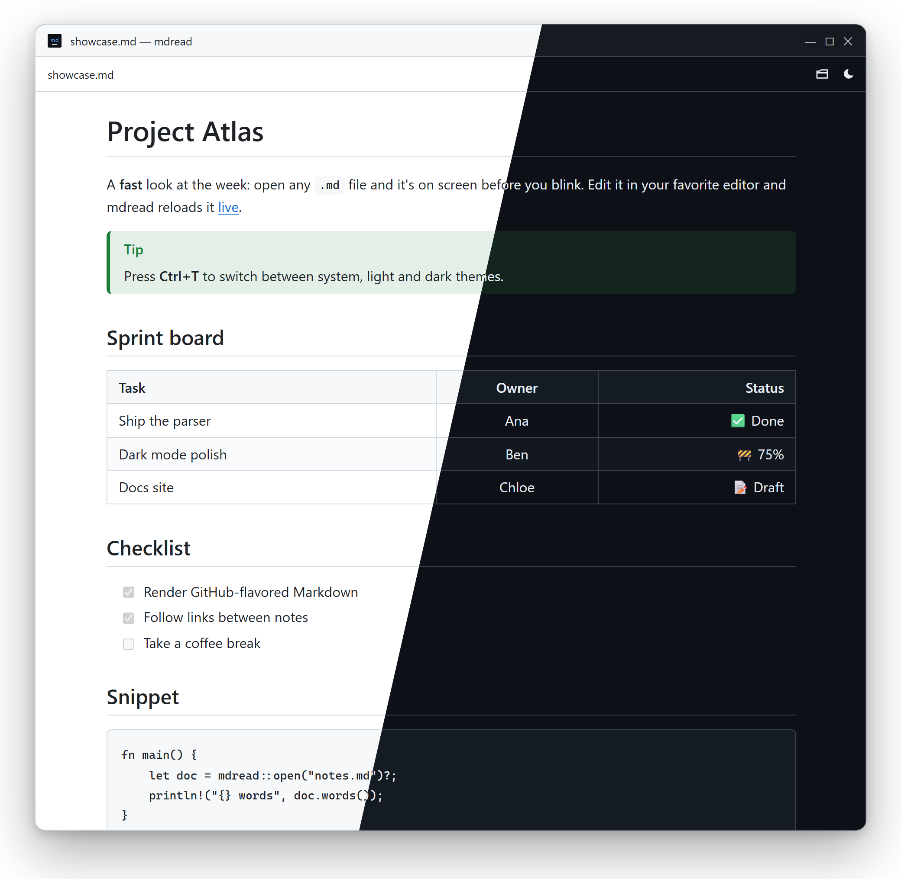

<p align="center">
  
</p>

<h1 align="center">mdread</h1>

<p align="center">
  <b>The fast Markdown (MD) reader for Windows.</b><br>
  Double-click a <code>.md</code> file. Read it. That's it.
</p>

<p align="center">
  <a href="https://github.com/mmoselhy/md-reader/releases/latest"></a>
  <a href="https://github.com/mmoselhy/md-reader/releases"></a>
  
  <a href="LICENSE"></a>
</p>

<p align="center">
  <a href="https://github.com/mmoselhy/md-reader/releases/download/v0.1.0/mdread_0.1.0_x64-setup.exe"><b>⬇ Download for Windows</b></a> (1.5 MB)
  &nbsp;·&nbsp; <a href="https://mmoselhy.github.io/md-reader/">Website</a>
  &nbsp;·&nbsp; <a href="#features">Features</a>
  &nbsp;·&nbsp; <a href="#keyboard">Shortcuts</a>
</p>

<p align="center">
  
</p>

---

## Why mdread?

To *read* a README or some notes on Windows, you usually reach for an editor: Notepad (Windows 11 formats basic Markdown, Windows 10 shows raw `#` and `**`), VS Code's preview pane, or a full note app. **mdread** is built only for reading: a tiny, focused **Markdown viewer** that opens `.md` files instantly, renders them the way GitHub does, and gets out of your way.

## Features

- ⚡ **Opens instantly.** Markdown is rendered natively in Rust and shown through the WebView2 built into Windows, with no bundled browser. A 1 MB file opens as fast as a tiny one.
- 🌗 **Light & dark.** Follows your Windows theme, or switch with <kbd>Ctrl</kbd>+<kbd>T</kbd>. It never flashes white when it opens.
- 🔄 **Live reload.** Save in VS Code, Notepad or Obsidian and the page updates where you were reading.
- ✅ **GitHub-flavored Markdown.** Tables, task lists, footnotes, strikethrough, autolinks and `> [!NOTE]` alerts. YAML front matter is hidden.
- 🔗 **Linked notes.** Relative images just work. Links to other `.md` files open in mdread, with back and forward.
- 🛡️ **Safe by default.** Scripts inside Markdown never run, and links to local programs are revealed in Explorer, never executed.
- 🪶 **Tiny.** A 1.5 MB installer with no account, no telemetry and no settings screen.

## Download

| | |
|---|---|
| **[Installer](https://github.com/mmoselhy/md-reader/releases/download/v0.1.0/mdread_0.1.0_x64-setup.exe)** (recommended) | Per-user install, no admin rights. Registers mdread for `.md`, `.markdown`, `.mdown`, `.mkd`, `.mkdn`. |
| **[Portable .exe](https://github.com/mmoselhy/md-reader/releases/download/v0.1.0/mdread-0.1.0-x64-portable.exe)** | A single file with no install: `mdread.exe notes.md` |

Requires Windows 10 or 11 (WebView2 is built in; the installer fetches it if missing). The builds aren't code-signed yet, so SmartScreen may warn: choose **More info → Run anyway**. Checksums are in every [release](https://github.com/mmoselhy/md-reader/releases).

## How to open .md files on Windows

1. Install mdread.
2. Double-click any `.md` file, drag it onto the window, or press <kbd>Ctrl</kbd>+<kbd>O</kbd>.
3. *(Optional)* Make it the default: right-click a `.md` file → **Open with** → **Choose another app** → **mdread** → **Always**.

## Keyboard

| Keys | Action |
|---|---|
| <kbd>Ctrl</kbd>+<kbd>O</kbd> | Open a file |
| <kbd>Ctrl</kbd>+<kbd>T</kbd> | Cycle theme: system → light → dark |
| <kbd>Ctrl</kbd>+<kbd>=</kbd> / <kbd>Ctrl</kbd>+<kbd>-</kbd> / <kbd>Ctrl</kbd>+<kbd>0</kbd> | Text size up / down / reset |
| <kbd>F5</kbd> | Reload |
| <kbd>Alt</kbd>+<kbd>←</kbd> / <kbd>Alt</kbd>+<kbd>→</kbd> | Back / forward through linked notes |

## How fast?

| | Release build, one Windows 11 machine |
|---|---|
| Double-click to readable window | ~0.45–0.6 s (mostly WebView2 startup, same as an empty window) |
| 1 MB Markdown file | opens as fast as a small one: the first screen is sent before the window shows, the rest streams in after |
| Rendering 1 MB of dense Markdown (Rust) | ~22 ms |

Your numbers will vary. The measuring method is in [SPEC.md](SPEC.md#1-goals-and-measurable-targets).

<details>
<summary><b>Build from source</b></summary>

Requirements: Windows 10/11, [Rust](https://rustup.rs) (stable, MSVC toolchain with Visual Studio Build Tools), and Node.js (only for the Tauri CLI and UI tests).

```
npx @tauri-apps/cli@2 build              # installer in src-tauri\target\release\bundle\nsis\
npx @tauri-apps/cli@2 build --no-bundle  # just src-tauri\target\release\mdread.exe
```

Tests:

```
cargo test --manifest-path src-tauri/Cargo.toml
node --test "tests/ui/*.test.mjs"
cargo test --release --manifest-path src-tauri/Cargo.toml -- --ignored --nocapture perf
```

The UI is plain HTML, CSS and JS in `src/`, with no bundler and no npm dependencies. The design and the Rust-to-UI contract are in [SPEC.md](SPEC.md).

</details>

## Roadmap ideas

Find in page · syntax highlighting · table of contents · print/PDF export · macOS and Linux builds. [Open an issue](https://github.com/mmoselhy/md-reader/issues) if you want one of these sooner.

## License

[MIT](LICENSE). Free for any use. If mdread saves you a few seconds every day, a ⭐ helps others find it.
